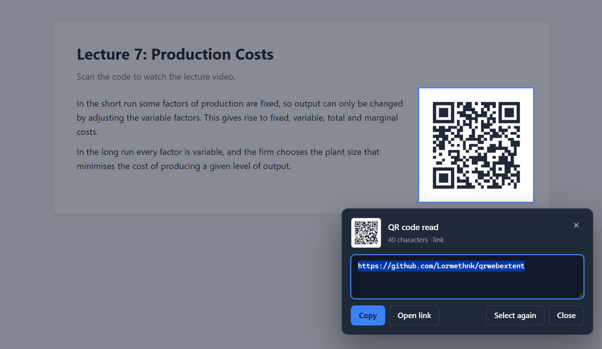

# QR Snip – Screen QR Reader


[](LICENSE)

A Chrome extension that works like the Windows Snipping Tool for QR codes: click the icon, drag over the area that contains a QR code, and copy its content.



## Features

- **Snipping-style selection:** the page is frozen while you select, so moving content (videos, animations) doesn't get in the way.
- **Works on PDFs too:** including QR codes in Chrome's built-in PDF viewer and local `file://` documents.
- **Robust decoding:** handles tight crops without a quiet zone, inverted codes, high-DPI screens, and small or blurry codes.
- **One-click actions:** copy the content, open http/https links in a new tab, or select again.
- **Private by design:** everything runs locally in your browser. The extension only touches a page when you click its icon and never sends data anywhere.
- **Light and dark theme:** follows your system setting.

## Installation

The extension is not on the Chrome Web Store yet; install it in developer mode:

1. Download this repository ([ZIP](https://github.com/Lormethnk/qrwebextent/archive/refs/heads/main.zip)) and extract it, or clone it:

   ```sh
   git clone https://github.com/Lormethnk/qrwebextent.git
   ```

2. Open `chrome://extensions` in Chrome.
3. Turn on **Developer mode** in the top-right corner.
4. Click **Load unpacked** and select the project folder (the one containing `manifest.json`).
5. Optionally pin **QR Snip** to the toolbar from the puzzle-piece menu.

## Usage

1. Click the QR Snip icon or press <kbd>Alt</kbd>+<kbd>Shift</kbd>+<kbd>Q</kbd>.
2. Drag to select the area containing the QR code.
3. Use **Copy**, **Open link** or **Select again** in the result panel.

Press <kbd>Esc</kbd>, right-click, or click the icon again to close the overlay. The shortcut can be changed at `chrome://extensions/shortcuts`.

> [!TIP]
> If a code isn't detected, make sure the selection covers the whole code. Very small codes, for example in a zoomed-out PDF, may need zooming in with <kbd>Ctrl</kbd>+<kbd>+</kbd> first.

## How it works

1. On click, the background service worker captures the visible tab with `chrome.tabs.captureVisibleTab`.
2. The selection overlay is injected into the page and displays that screenshot, so the page appears frozen.
3. The selected area is cropped at full device resolution and decoded with Chrome's `BarcodeDetector` where available (macOS, ChromeOS, Android) or with [jsQR](https://github.com/cozmo/jsQR) otherwise. Several scaled and padded variants are tried, which matters for small codes.
4. Pages that don't allow script injection (Chrome Web Store, the PDF viewer, `file://` pages without file access) get the same UI in a separate extension tab.

### Project structure

```
├── manifest.json        Extension manifest (MV3)
├── background.js        Icon/shortcut handler: capture + injection
├── content/
│   └── snip.js          Selection overlay, cropping, decoding, result panel
├── snip.html            Fallback tab for pages that block injection
├── fallback.js          Starts the overlay inside the fallback tab
├── lib/
│   ├── jsQR.js          QR decoder (jsQR 1.4.0, unmodified)
│   └── jsQR-LICENSE.txt
├── icons/               Toolbar and store icons
├── docs/                README assets
└── LICENSE              MIT
```

### Permissions

| Permission | Why |
| --- | --- |
| `activeTab` | Capture and script the current tab, only after you click the icon or use the shortcut. |
| `scripting` | Inject the selection overlay into that tab. |

No host permissions are requested, so the extension cannot read any page on its own.

## Limitations

- Internal browser pages (`chrome://...`, the New Tab page) can't be captured; a red `!` briefly appears on the icon.
- Only the visible part of the page is captured. Scroll the code into view first.
- One QR code is read per selection.

## License

This project is released under the [MIT License](LICENSE).

It bundles one third-party library, which keeps its own license:

| Component | License |
| --- | --- |
| [jsQR](https://github.com/cozmo/jsQR) 1.4.0 (`lib/jsQR.js`) | [Apache-2.0](lib/jsQR-LICENSE.txt) |

The extension has no other dependencies and loads nothing from the network.
